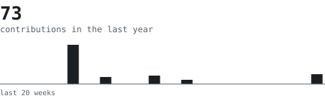
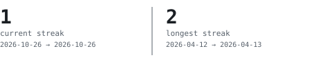
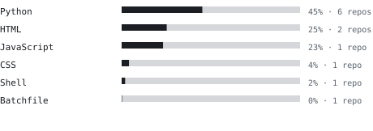

<table><tr><td align="center">

<picture>
  <source media="(prefers-color-scheme: dark)" srcset="svg/portrait-dark.svg">
  
</picture>

<picture>
  <source media="(prefers-color-scheme: dark)" srcset="svg/hd-about-dark.svg">
  
</picture>

<!-- edit this blurb -->
<blockquote>
Software developer. I build things, break things, and occasionally 
fix the things I broke.
</blockquote>

<!-- edit this stack line -->
<samp>
Python · TypeScript · React · Node
</samp>

  

<picture>
  <source media="(prefers-color-scheme: dark)" srcset="svg/hd-stats-dark.svg">
  
</picture>

<picture>
  <source media="(prefers-color-scheme: dark)" srcset="svg/stats-dark.svg">
  
</picture>

 

<picture>
  <source media="(prefers-color-scheme: dark)" srcset="svg/hd-streak-dark.svg">
  
</picture>

<picture>
  <source media="(prefers-color-scheme: dark)" srcset="svg/streak-dark.svg">
  
</picture>

 

<picture>
  <source media="(prefers-color-scheme: dark)" srcset="svg/hd-langs-dark.svg">
  
</picture>

<picture>
  <source media="(prefers-color-scheme: dark)" srcset="svg/langs-dark.svg">
  
</picture>

 

<picture>
  <source media="(prefers-color-scheme: dark)" srcset="svg/hd-year-dark.svg">
  
</picture>

<picture>
  <source media="(prefers-color-scheme: dark)" srcset="svg/year-dark.svg">
  
</picture>

  

<picture>
  <source media="(prefers-color-scheme: dark)" srcset="svg/hd-connect-dark.svg">
  
</picture>

<!-- edit these -->
<samp>
email → you@example.com · linkedin → linkedin.com/in/your-handle
</samp>

</td></tr></table>
